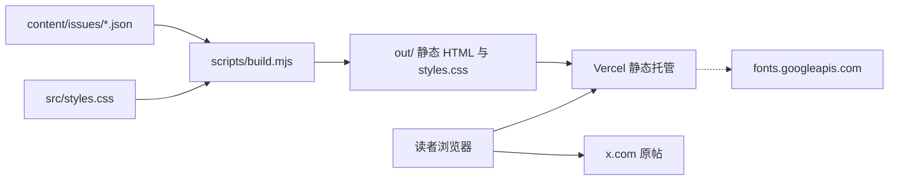

# Architecture

「每日 AI 热帖」是一个无框架静态网站：把仓库中的期次 JSON 构建成可部署的 HTML 页面。读者只获取静态文件，站点本身没有运行时服务、用户账号或后端 API。

## Purpose and scope
- **目标**：把 X 上关于 AI 与 AI 智能体的热帖，整理成可打开、可分享的中文每日简报。
- **职责**：校验期次 JSON，生成首页、往期列表和单期页面，并复制站点样式。
- **非目标（当前未实现）**：访问统计、把每日 10:00 简报例行任务自动写入期次、分享卡片图、自定义域名、自动发帖。
- **权威产品约定**：根目录 [README.md](../README.md)。

## Context and trust boundaries
- 期次内容是本仓库中的可信输入（`content/issues/*.json`），构建时仍会做结构校验。
- 生成的 HTML 对标题、摘要、标签等字段做 HTML 转义；作者主页链接会对 `author_handle` 做 `encodeURIComponent`；`post_url` 必须匹配 `https://x.com/{handle}/status/{id}`。
- 读者浏览器只请求静态资源。页面会加载 Google Fonts（Noto Sans SC、Noto Serif SC），条目和作者链向 `x.com`。
- 当前公开站点是 <https://ai-daily-flame.vercel.app>。仓库内 [`vercel.json`](../vercel.json) 指定 `buildCommand` 为 `npm run build`，`outputDirectory` 为 `out`，`framework` 为 `null`。Git 仓库与该 Vercel 项目的自动关联不在本文断言范围内。

## Components

| 组件 | 职责 | 源码 |
|---|---|---|
| 期次内容 | 每期一篇 JSON，文件名 `YYYY-MM-DD.json` | [`content/issues/`](../content/issues/) |
| 静态生成器 | 读取、校验、排序并渲染页面 | [`scripts/build.mjs`](../scripts/build.mjs) |
| 样式 | 站点 CSS，构建时复制到输出目录 | [`src/styles.css`](../src/styles.css) |
| 构建清单 | npm 脚本入口，无运行时依赖 | [`package.json`](../package.json) |
| 部署配置 | Vercel 构建命令与输出目录 | [`vercel.json`](../vercel.json) |
| 生成结果 | 可部署的静态文件；不入库 | `out/`（由 `.gitignore` 忽略） |

## Critical data flows
入口是 `npm run build`，实际执行 `node scripts/build.mjs`：

1. `loadIssues()` 读取 `content/issues/*.json`，解析 JSON，调用 `validateIssue()`。文件名必须与字段 `date` 一致。
2. 按 `date` 降序排序；若没有任何有效期次则失败。
3. 清空并重建 `out/`，把 `src/styles.css` 复制为 `out/styles.css`。
4. 用最新一期渲染 `out/index.html`（首页，导航「本期」）。
5. 渲染 `out/issues/index.html`（往期列表）。
6. 为每一期渲染 `out/issues/YYYY-MM-DD/index.html`。

页面路由由此产生：`/`、`/issues/`、`/issues/YYYY-MM-DD/`，样式为 `/styles.css`。规范 URL 在 HTML 中写成这些路径，生成器不写入站点绝对域名。

本地预览：`npm run serve` 先构建，再用 `python3 -m http.server 4173 --directory out`，地址为 <http://127.0.0.1:4173/>。

## Architecture constraints
| Constraint | Rationale | Verification | Source |
|---|---|---|---|
| 不使用前端框架，单脚本生成静态 HTML | 保持构建简单，便于后续接到自动更新流程，也便于放到 Vercel | `package.json` 无 runtime 依赖；构建命令为 `node scripts/build.mjs` | [`package.json`](../package.json)、[ADR-0001](decisions/0001-no-framework-static-generator.md) |
| 生成物不入库 | `out/` 可重建，避免提交过期 HTML | `.gitignore` 包含 `out/` | [`.gitignore`](../.gitignore) |
| 用户可见文案为简体中文 | 产品约定 | 页面 `lang="zh-CN"`，页脚与导航为中文 | [`scripts/build.mjs`](../scripts/build.mjs)、[README](../README.md) |

## Security and reliability
- 没有登录、授权、多租户或服务端密钥处理。构建脚本不读取环境变量或密钥。
- 输入校验集中在 `validateIssue()`：校验日期、必填字符串、`author_handle` 不得带 `@`、`post_url` 格式、`tags` 必须是数组、`caveat` 若出现则必须非空。
- 渲染时使用 `escapeHtml()`，降低期次字段中的 HTML 注入风险。
- 构建失败会抛出错误并退出；没有重试、降级或增量构建。
- README 的采编约定要求只收录真实原帖，不编造链接或数字；这是编辑约束，构建脚本只校验格式，不核查链接是否真实存在。

## Decisions and related docs
- [ADR-0001：无框架静态生成](decisions/0001-no-framework-static-generator.md)
- [静态站点生成器](subsystems/static-site-generator.md)
- [开发指南](development.md)
- [测试策略](testing.md)
- [发布新期次](runbooks/publish-issue.md)
