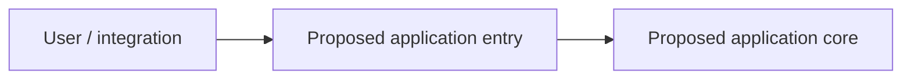

# Technical Design: <Project / capability>

> **Status:** Proposed
> **Owner:** TBD
> **Last reviewed:** YYYY-MM-DD
> **Related PRD:** TBD
> **Nature:** Intended architecture — not an assertion about running code

## 1. Summary and design objectives

Briefly explain the chosen direction, supported requirements and design boundaries.

## 2. Requirements mapping

| Requirement ID | Proposed mechanism | Verification / deliverable |
|---|---|---|
| FR-001 | TBD | TBD |

Call out relevant non-functional constraints and non-goals. Avoid features that are not needed for the first milestone.

## 3. Alternatives and trade-offs

| Option | Strengths | Weaknesses | Decision / reason |
|---|---|---|---|
| A | TBD | TBD | TBD |
| B | TBD | TBD | TBD |

Create a separate ADR for consequential and lasting choices; link it here.

## 4. Proposed system boundaries

- Runtime/platform:
- Entry points:
- Components/subsystems:
- External integrations:
- Trust/security boundaries:
- Persistent data (only if required):

This diagram is a proposal, not a current implementation map.

## 5. Component responsibilities

| Proposed component | Responsibility | Inputs / outputs | Dependencies |
|---|---|---|---|
| Entry / UI / interface | TBD | TBD | TBD |
| Core | TBD | TBD | TBD |

Do not invent source paths before code exists. Record directory choices here as *proposed*.

## 6. Runtime flows

Describe important scenarios end to end:
1. Inputs and validation.
2. Authentication / authorization (if applicable).
3. Dispatch, business logic and dependencies.
4. Persistence / external side effects (if applicable).
5. Results, output, errors and cleanup.

Include normal, exceptional and cancellation/timeout flows.

## 7. Interface contracts

Link to the relevant **proposed** contract: CLI commands, Web routes/UX, App screens/lifecycle, HTTP/gRPC/SDK or Events. Keep detailed contracts in their owning proposal, not copied into this architecture document.

## 8. Configuration and data

- Platform-appropriate configuration precedence (CLI flags, environment, config files, runtime settings or managed App preferences).
- Compatibility and versioning.
- Storage and schema design (only if required).
- Atomicity, concurrency and recovery considerations.

## 9. Security, reliability and operations

- Input validation, untrusted data and permission boundaries.
- Secret storage, output and log redaction.
- Timeout, cancellation, retry, idempotency and resource cleanup.
- Installation/distribution, code versioning, upgrade, backward compatibility and rollback (see [Versioning policy](../versioning.md)).
- Observability and error diagnostics.

## 10. Test strategy

| Scenario / requirement | Test level | Expected evidence |
|---|---|---|
| TBD | Unit / Integration / E2E / Security | TBD |

Tests listed before implementation are **planned tests**, not passed tests.

## 11. Delivery plan

| Phase | Scope | Deliverables | Acceptance gate |
|---|---|---|---|
| M0 | Project scaffold | TBD | TBD |
| M1 | Smallest usable vertical slice | TBD | TBD |
| M2 | Additional behavior | TBD | TBD |

Each phase should be small enough for a coding Agent to implement and verify. Identify prerequisites and risky transitions.

## 12. Open questions and assumptions

| Issue | Assumption / options | Owner | Blocking? |
|---|---|---|---|
| TBD | TBD | TBD | TBD |

## 13. Design review and handoff

- Review decision: Pending / Changes requested / Accepted
- Accepted by: TBD
- Accepted on: TBD
- Related ADRs: TBD
- Handoff to coding Agent: TBD

Do not claim implementation completion merely because a design was Accepted.
